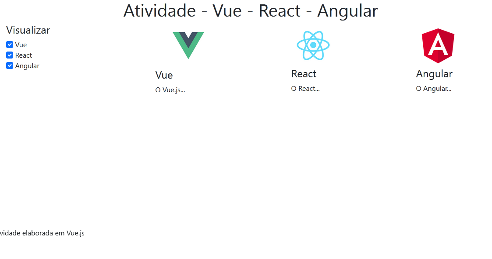

# 🧩 Programação de Scripts — Atividades em HTML, CSS e JavaScript

Atividades da disciplina de **Programação de Scripts** na **Fatec Taquaritinga**: páginas em **HTML e CSS**, scripts em **JavaScript** (DOM, classes e funções) e formulários com **Vue.js** e **React**.

🌐 **Página inicial:** [`index.html`](index.html), com links para todas as atividades.

---

## 📋 Atividades

| # | Arquivo | O que é | Conceitos |
|:---:|---|---|---|
| 01 | [`01-site-stranger-things.html`](01-site-stranger-things.html) | Site sobre uma série | HTML semântico, CSS, lista, tabela e vídeo (iframe) |
| 02 | [`02-correcao-de-erros.html`](02-correcao-de-erros.html) | Atividade de **correção de erros** | Estrutura HTML5, atributos e JavaScript |
| 03 | [`03-cadastro-de-clientes.html`](03-cadastro-de-clientes.html) | Cadastro de clientes | Classes em JS, métodos, arrays e DOM |
| 04 | [`04-cadastro-de-carros.html`](04-cadastro-de-carros.html) | Cadastro de carros | Classes, formulário, lista dinâmica e CSS |
| 05 | [`05-confirmacao-de-exclusao.html`](05-confirmacao-de-exclusao.html) | Confirmação de exclusão | Eventos `onclick` e alteração de estilo |
| 06 | [`06-formulario-contato-vue2.html`](06-formulario-contato-vue2.html) | Formulário de contato | **Vue 2**: `v-model`, `v-if` e validação |
| 07 | [`07-formulario-contato-vue3.html`](07-formulario-contato-vue3.html) | Formulário com tabela | **Vue 3**: `createApp`, `v-for` e validação |
| 08 | [`08-perguntas-html-e-js.html`](08-perguntas-html-e-js.html) | Perguntas sobre HTML e JS | `select`, tabela de histórico e funções |
| 09 | [`09-exercicios-academia-react.html`](09-exercicios-academia-react.html) | Catálogo de exercícios | **React**: `useState`, busca, filtros, cadastro e modal |
| 10 | [`10-calculadora.js`](10-calculadora.js) | Calculadora | Função com `switch` para as 4 operações |

---

## 🛠️ Atividade 02 — erros corrigidos

| # | Erro | Correção |
|:---:|---|---|
| 1 | DOCTYPE do HTML 4.01 | `<!DOCTYPE html>` (HTML5) |
| 2 | `charset="ISO-8859-1"` com o arquivo em UTF-8 | `charset="UTF-8"` |
| 3 | `type="txt/javascript"` | `type="text/javascript"` |
| 4 | `Alert(...)` | `alert(...)`: JavaScript diferencia maiúsculas |
| 5 | Faltava `</head>` | Tag adicionada |
| 6 | `<footer>` no início e `<header>` no fim | `<header>` no topo e `<footer>` no final |
| 7 | Conteúdo principal dentro do `<nav>` | Tabela e lista movidas para o `<main>` |
| 8 | `hrf=` | `href=` |
| 9 | `target="blank"` | `target="_blank"` |
| 10 | Linhas da tabela sem `</tr>` | Linhas fechadas |
| 11 | Última linha com 2 células | Completada para 3 células |
| 12 | `console.Log(...)` | `console.log(...)` |
| 13 | Faltava `</body>` | Tag adicionada |
| 14 | `` sem `alt` | Texto alternativo adicionado |

Cada correção está marcada com um comentário `<!-- CORRIGIDO -->` no código.

---

## 🖼️ Atividade Vue · React · Angular



Página feita em **Vue.js** que mostra ou esconde os cards de cada framework pelas caixas de seleção.

---

## 🧮 Calculadora

```javascript
function calcular(operacao, num1, num2) {
    switch (operacao) {
        case 'adição':        return num1 + num2;
        case 'subtração':     return num1 - num2;
        case 'multiplicação': return num1 * num2;
        case 'divisão':
            if (num2 === 0) return 'Não é possível dividir por zero';
            return num1 / num2;
        default:              return 'Operação inválida';
    }
}
```

Para rodar: `node 10-calculadora.js`

---

## 🚀 Como ver

- **Online:** ative o **GitHub Pages** (Settings → Pages → Branch `main` → Save) e abra o link gerado.
- **No computador:** baixe o repositório e abra o `index.html` no navegador.

As páginas com Vue e React carregam as bibliotecas pela internet (CDN), então precisam de conexão.

---

## 🎓 Informações acadêmicas

| | |
|---|---|
| **Instituição** | Fatec Taquaritinga |
| **Curso** | Análise e Desenvolvimento de Sistemas |
| **Disciplina** | Programação de Scripts |
| **Professor** | Giuliano Scombatti Pinto |
| **Ano** | 2025–2026 |

## 👥 Autores

- Juan Gabriel Pereira Augusto
- Daniel Freire Kim (atividade 08)
